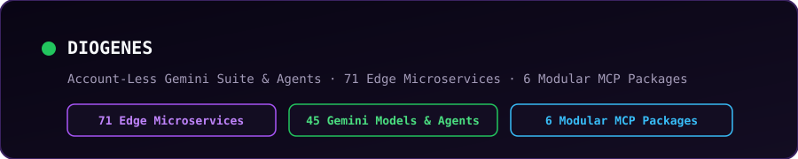

# DIOGENES // AUTONOMOUS AI GATEWAY ARCHITECT

<p align="center">
  
</p>

---

### [>] Flagship Gateway: [stand-out-of-my-sun/diogenes-micro-gateway](https://github.com/stand-out-of-my-sun/diogenes-micro-gateway)
- **Live Edge Portal**: https://diogenes-micro-gateway.corinth.workers.dev
- **MCP Server Endpoint**: `https://diogenes-micro-gateway.corinth.workers.dev/mcp` (`/.well-known/mcp.json`)
- **OpenAPI 3.1.0 Specification**: `https://diogenes-micro-gateway.corinth.workers.dev/openapi.json`
- **LLM Discovery Manifest**: `https://diogenes-micro-gateway.corinth.workers.dev/llms.txt`

Pay-per-request intelligence for autonomous AI agents and developers across live edge microservices. No API keys or accounts required—settle per request in **Bitcoin Lightning (L402)**, **Solana USDC (x402)**, or **Base USDC (MPP)**.

---

### [::] Complete Gemini Model Suite (Account-Less Access)

Instant pay-per-query access to Google's complete Tier 1 model catalog and autonomous agents alongside Diogenes proprietary microservices with zero API keys, accounts, or monthly subscriptions:

- **Antigravity Agent** (`POST /api/v1/ai/antigravity-agent` | 500 sats): Google's premier autonomous agent with remote code execution, sandboxed tool use, and multi-step reasoning.
- **Deep Research Pro Preview** (`POST /api/v1/ai/deep-research` | 1,000 sats): Multi-hour autonomous investigative research engine delivering dense, verified intelligence dossiers.
- **Nano Banana Pro (Gemini 3 Pro Image)** (`POST /api/v1/ai/image-gen?model=gemini-3-pro-image` | 600 sats): Professional-grade high-resolution multimodal digital art, architectural diagrams, and visual UI generation.
- **Nano Banana (Gemini 2.5 Flash Image)** (`POST /api/v1/ai/image-gen?model=gemini-2.5-flash-image` | 350 sats): Rapid prompt-adherent image and vector synthesis.
- **Gemini 4 Argon (Frontier Reasoning)** (`POST /api/v1/ai/generate?model=gemini-4-argon` | 250 sats): Next-generation reasoning with configurable thinking budgets and search grounding.
- **Complete Gemini 3.x & 2.5 Family**: Full access to Gemini 3.8/3.7/3.6 Flash, Gemini 3.1 Pro, Gemini 2.5 Pro/Flash, and Robotics ER-2 (45 models total via `GET /api/v1/models`).

---

### [::] Core Capabilities & Architecture

| Domain | Protocol | Functionality |
| :--- | :--- | :--- |
| **Frontier AI & Agents** | MCP / L402 | Account-less access to Antigravity agent, Deep Research Pro, Nano Banana (Pro), and 45 Gemini models |
| **Security & Guardrails** | MCP / L402 | Pre-execution prompt injection defense, regex oracles, and credential exfiltration blocking |
| **Smart Contract Audits** | MCP / L402 | Bytecode analysis, vulnerability audits, and Solana token risk scoring |
| **Agent Tool Execution** | MCP / L402 | Deterministic tool execution, schema enforcement, and JSON-RPC payload repair |
| **EVE Frontier Engine** | MCP / L402 | Sui Move assembly synthesis, stargate jump route planning, and network fuel telemetry |

---

### [+] Remote MCP Quickstart

Connect Claude Desktop, Cursor, Antigravity, or any Model Context Protocol client directly to the edge gateway:

```json
{
  "mcpServers": {
    "diogenes": {
      "url": "https://diogenes-micro-gateway.corinth.workers.dev/mcp"
    }
  }
}
```
