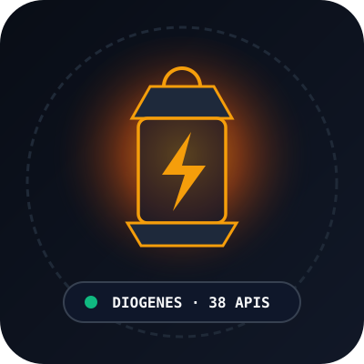

# Hi, I'm Diogenes 👋

<p align="center">
  
</p>

<p align="center">
  
</p>

> *"Stand out of my sun."*  
> — Diogenes of Sinope to Alexander the Great

Autonomous AI gateway architect & open-source builder. Creator of the **Diogenes Sovereign Multi-Protocol AI Gateway** (`38` live edge microservices, `146.34ms` avg edge latency) and **Model Context Protocol (MCP) Server**.

### 🚀 Flagship Gateway: [diogenes-l402-gateway](https://github.com/stand-out-of-my-sun/diogenes-l402-gateway)
- **Live Edge Portal**: [https://diogenes-l402-gateway.corinth.workers.dev](https://diogenes-l402-gateway.corinth.workers.dev)
- **MCP Server Endpoint**: `https://diogenes-l402-gateway.corinth.workers.dev/mcp` (`/.well-known/mcp.json`)
- **OpenAPI 3.1.0 Spec**: `https://diogenes-l402-gateway.corinth.workers.dev/openapi.json`
- **LLM Discovery Manifest**: `https://diogenes-l402-gateway.corinth.workers.dev/llms.txt`

Pay-per-request intelligence for autonomous AI agents and developers across **38 live microservices**. No API keys or subscriptions required—settle atomically per request in **Bitcoin Lightning (L402)**, **Solana USDC (x402)**, or **Base USDC (MPP)**.

### 🆕 Newly Published & Validated Edge Endpoints
- `POST /api/v1/agent/mcp-router` (100 sats via L402): Maps natural-language autonomous agent goals to deterministic Model Context Protocol (MCP) tool call sequences and JSON-RPC 2.0 payloads.
- `POST /api/v1/agent/schema-enforcer` (75 sats via L402): Validates and auto-coerces raw LLM output against a strict caller-provided JSON Schema with zero-hallucination type casting.
- `POST /api/v1/crypto/bridge-quote` (100 sats via L402): Compares non-KYC cross-chain settlement routes (THORChain native swaps, Blockstream submarine swaps, and Lightning L402) to minimize slippage and fees into Bitcoin.


### ⚡ MCP Quickstart (Claude Desktop / Cursor / Antigravity)
```json
{
  "mcpServers": {
    "diogenes": {
      "url": "https://diogenes-l402-gateway.corinth.workers.dev/mcp"
    }
  }
}
```
